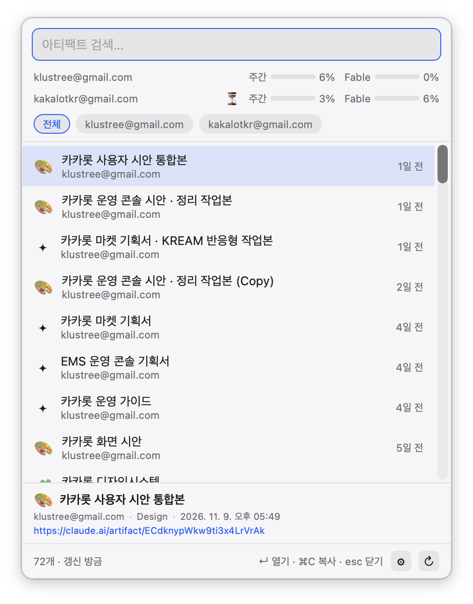

# Queenfish

여러 Claude 계정의 **아티팩트**와 **사용량(5시간 세션 / 주간 / 모델별 주간 한도)**,
그리고 **Codex(ChatGPT 플랜) 사용량**을 Maccy처럼 메뉴바 + 전역 단축키 패널로 빠르게 보는
macOS 앱. Rust + Tauri v2. MIT 라이선스.

<p align="center"></p>

## 설치

[Releases](https://github.com/YOOZ-JP/queenfish/releases)에서 `.dmg`를 받아 `Queenfish.app`을
응용 프로그램 폴더로 옮긴다 (Apple Silicon, macOS 12+).

Apple 개발자 서명이 없는 빌드라 처음 열 때 Gatekeeper가 막는다. 아래 중 하나로 허용한다.

```bash
xattr -dr com.apple.quarantine /Applications/Queenfish.app
```

또는 한 번 실행을 시도한 뒤 **시스템 설정 → 개인정보 보호 및 보안 → "그래도 열기"**.

## 동작 방식

쿠키/스크래핑 없이, 로컬에 이미 존재하는 **Claude Code OAuth 자격증명**을 그대로 사용한다
(Orca가 사용량을 조회하는 방식과 동일).

| 데이터 | 방법 |
|---|---|
| 자격증명 발견 | macOS Keychain의 `Claude Code-credentials*` 항목 전부(프로필별 접미사 포함) + 각 홈(기본/Orca 프로필/`custom_homes`)의 `.credentials.json` — 액세스 토큰 기준 중복 제거 |
| 계정 식별 | `GET https://api.anthropic.com/api/oauth/profile` → 토큰의 실소유 이메일 (라벨/중복 판정의 기준) |
| 사용량 | `GET https://api.anthropic.com/api/oauth/usage` (`Authorization: Bearer`, `anthropic-beta: oauth-2025-04-20`) |
| 아티팩트 | `https://claude.ai/api/artifacts/mcp` (Claude Code가 쓰는 artifacts MCP 서버의 `list_artifacts` 툴). 내 항목 + 공유받음(`shared_only`) 둘 다 조회, 리스트에 `공유받음` 배지/필터 표시 |
| 토큰 갱신 | Queenfish가 직접 추가한 계정만 만료 시 refresh-token grant로 갱신하고, 새 토큰을 Queenfish 전용 Keychain 항목에 다시 저장. Claude Code/Orca가 저장한 로그인은 **갱신하지 않는다** — refresh token이 1회용이라 대신 갱신하면 그 앱이 로그아웃되기 때문. 만료되면 "토큰 만료"로 표시되고, 해당 계정으로 Claude를 한 번 실행하면 다시 표시된다 |
| Codex 로그인 발견 | Codex CLI의 `auth.json` — `$CODEX_HOME`, `~/.codex`, Orca가 관리하는 Codex 계정 홈, `custom_codex_homes`. 같은 계정이 여러 곳에 있으면 만료가 가장 늦은 토큰 하나만 사용 |
| Codex 사용량 | `GET https://chatgpt.com/backend-api/wham/usage` (`Authorization: Bearer`, `ChatGPT-Account-Id`) → 플랜 + 한도 창(5시간/주간)별 사용률·초기화 시각. Codex CLI·Orca와 같은 방식 |

> 사용량/아티팩트 엔드포인트는 공식 공개 API가 아니라 Claude Code·Orca가 쓰는 내부
> 표면이다. 예고 없이 바뀔 수 있다. 참고:
> [usage 엔드포인트 분석 (dev.to)](https://dev.to/msadofschi/where-claudes-usage-limits-went-from-sse-to-protobuf-frames-c8d),
> [claude usage 커맨드 요청 이슈](https://github.com/anthropics/claude-code/issues/44328)

## 실행

```bash
cd src-tauri
cargo run
```

- 첫 실행 시 Keychain 접근 대화상자가 뜨면 **항상 허용**을 누른다.
- 메뉴바의 `✦` 아이콘, 전역 단축키 **⌘⇧A** 로 패널을 연다.
- 패널: 타이핑으로 검색, `↑↓` 이동, `↵` 열기(기본 브라우저), `⌘C` 링크 복사, `esc` 닫기, `⌘R` 새로고침.
- 선택한 항목의 **미리보기**(제목·설명·종류·계정·수정시각·URL)가 하단에 표시된다.
- 아티팩트 링크를 검색창에 붙여넣고 `↵` 하면 목록에 고정된다 (여러 개 한번에 가능).
- 계정·고정 링크 관리는 설정 창에서 한다: 패널 `⚙` 버튼, `⌘,`, 또는 트레이 메뉴(✦)의 계정 관리.
- 데이터는 15분마다, 그리고 패널을 열 때(60초 스로틀) 갱신된다. 429를 만나면
  이전 데이터를 유지한 채 10분 쿨다운한다.

## 계정 추가 / 삭제

- **앱 내 추가**: 설정 창의 `＋ 계정 추가` → 기본 브라우저에서 claude.ai 로그인(OAuth PKCE, 본인이 직접
  로그인) → 토큰은 Queenfish 전용 Keychain 항목(`Queenfish-credentials-<email>`)에 저장.
  Claude Code의 Keychain 항목은 절대 건드리지 않는다.
- **삭제**: 설정 창의 계정 카드에서 `삭제`/`숨김` → 한 번 더 클릭으로 확정.
  - Queenfish로 추가한 계정 → Keychain에서 실제 삭제
  - Claude Code/Orca/Codex가 관리하는 계정 → 목록에서 **숨김**만 (로그아웃은 해당 앱에서).
    숨긴 계정은 설정 창에서 복원.
- **Orca 경유**: Orca에 다른 계정으로 로그인하면(`claude-profiles` 프로필 생성) 자동 인식.
  참고로 Orca는 자체 OAuth 없이 Claude Code 로그인 플로우를 프로필 폴더(HOME 분리)에서
  실행하는 방식이고, Queenfish는 같은 OAuth 클라이언트로 직접 로그인한다.
- **수동**: 별도 디렉터리에 `CLAUDE_CONFIG_DIR=<dir> claude` 로 로그인한 뒤,
  `~/Library/Application Support/com.worxfact.queenfish/config.json` 에 추가:

  ```json
  { "custom_homes": ["/path/to/that/home"] }
  ```

## Codex 계정

별도 로그인 절차 없이 이 맥의 Codex CLI 로그인을 그대로 읽어 사용량 행에 `Codex` 태그로 표시한다
(아티팩트 목록은 Claude 전용).

- Codex 토큰은 Queenfish가 **갱신하지 않는다**. Codex의 refresh token은 1회용이라 여기서 갱신하면
  CLI에 저장된 로그인이 무효가 되기 때문이다. 만료되면 "토큰 만료" 안내가 뜨고, 해당 계정으로
  Codex를 한 번 실행하면 다시 표시된다.
- 다른 위치의 Codex 홈(`CODEX_HOME=<dir> codex` 로 로그인한 경우)은 config.json에 추가:

  ```json
  { "custom_codex_homes": ["/path/to/codex/home"] }
  ```

## 번들(.app / .dmg) 만들기

```bash
cd src-tauri
npx @tauri-apps/cli build
# 결과물: src-tauri/target/release/bundle/macos/Queenfish.app
#         src-tauri/target/release/bundle/dmg/Queenfish_0.1.0_aarch64.dmg
```

서명 없이 빌드되므로(ad-hoc) 다른 맥에서 열 때는 우클릭 → 열기가 필요할 수 있다.

## 구조

```
ui/                  정적 프런트엔드 (검색 패널, 사용량 게이지, 설정 창)
src-tauri/src/
  lib.rs             트레이, 전역 단축키, 패널 토글, 새로고침 루프, 커맨드
  accounts.rs        Claude 계정 발견 + 자격증명 로드(파일/Keychain) + 앱 설정
  api.rs             Claude usage API + artifacts MCP 클라이언트 + 토큰 갱신
  oauth.rs           앱 내 Claude 계정 추가 (OAuth PKCE)
  codex.rs           Codex 로그인 발견 + 사용량 조회
```
